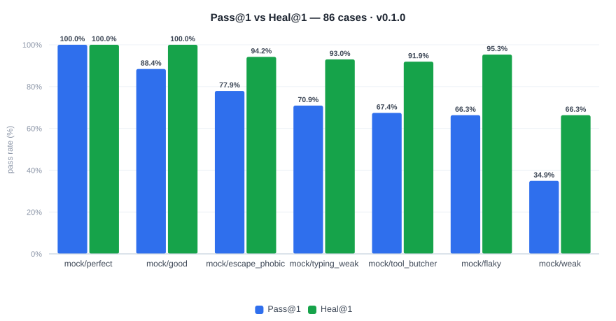
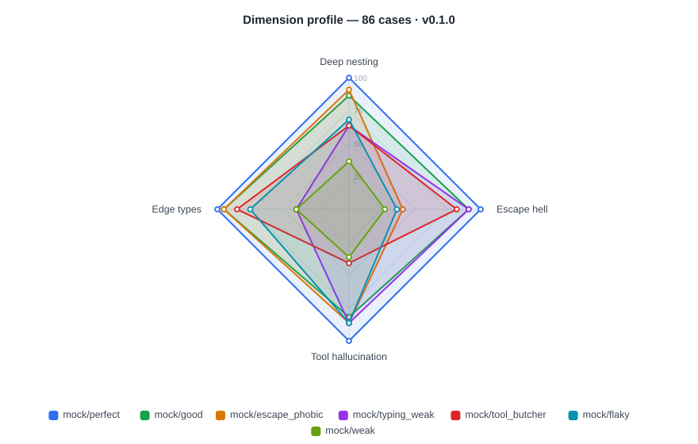
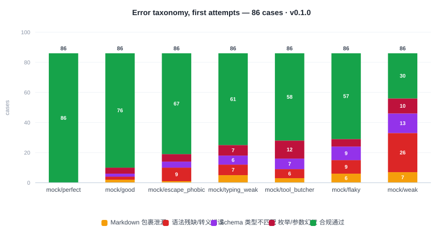

<div align="center">

# StructBench

**面向大模型结构化输出与工具调用的轻量级压力评测基准。**

*Stress-testing LLMs on extreme JSON schemas, nested tool calls, and self-healing recovery.*

[English](README.md) | **简体中文**

[](https://github.com/dshjfdsh/StructBench/actions/workflows/ci.yml)
[](https://www.python.org/)
[](LICENSE)
[](tests/)
[](datasets/)
[](#为什么不用-llm-当裁判)

</div>

---

## 为什么要再造一个评测基准？

因为「这个模型 JSON 能力不错」根本不是一个可证伪的命题；而真正让 Agent 在生产环境崩掉的，往往不是一个答错的答案，而是一个**没闭合的大括号**。

StructBench 是一个定位极窄的**微基准（micro-benchmark）**：它只问一件事——模型能不能产出**程序可以直接消费**的输出？要么是符合给定 Schema 的严格 JSON，要么是一个格式正确的工具调用。它用 86 道手工构造的对抗性用例覆盖四个维度，把每一次失败精确归因到五类病灶之一，并且额外测量一件关键能力：**当把精确的报错信息喂回去时，模型能否自愈修复？**

| | |
| :--- | :--- |
| **不需要裁判模型** | 每个判定都来自 JSON 解析器 + Pydantic v2 校验器：零成本、毫秒级、100% 可复现。 |
| **不需要 API Key** | 内置 7 个离线模拟人格可跑通整条流水线，克隆下来一分钟内就能看到真实报告。 |
| **不止于 Pass@1** | `Heal@1` 量化了对 Agent 运行时真正重要的指标：收到校验错误后的恢复能力。 |
| **失败是可行动的** | 不是笼统的「失败」，而是 `Syntax_Truncated / unclosed_bracket` at `$.user.tags`——这是一份 bug 报告，不是一个分数。 |

### 五类错误病灶

StructBench 从不给出干巴巴的通过/失败。每一次失败的尝试都会被归因到唯一一个根因，其下还有约 40 个细粒度子码：

| 标签 | 中文 | 含义 |
| :--- | :--- | :--- |
| `Markdown_Wrapper_Leak` | Markdown 包裹泄漏 | JSON 本身合法，但被 ```` ```json ```` 代码块包裹，或前后夹带了寒暄与说明文字。 |
| `Syntax_Truncated` | 语法残缺/转义错误 | 完全无法解析：括号不配平、字符串未闭合、非法转义、多余尾逗号。 |
| `Schema_Type_Mismatch` | Schema 类型不匹配 | JSON 合法但结构不符：缺少必填字段，或在需要整数处输出了 `"123"`。 |
| `Enum_Or_Value_Hallucination` | 枚举/参数幻觉 | 结构正确但取值是编造的：自造枚举值、多出未声明字段、虚构工具参数。 |
| `Valid_Pass` | 合规通过 | 完全符合契约。 |

---

## 四大评测维度

题库包含 **86 道对抗性用例**，每一道都经过验证：**有解**（存在能通过的响应）且**能区分**（显然的篡改必须失败）——详见[题库完整性](#题库完整性)。

| 维度 | 用例数 | 攻击目标 |
| :--- | ---: | :--- |
| `deep_nesting` | 22 | 深度 ≥ 4 层嵌套、`anyOf`/`oneOf` 联合类型、严格 `enum`/`const`、`pattern`、`format`、类型数组、`allOf` + `$defs`/`$ref`、数值边界。 |
| `escape_hell` | 22 | 把**硬内容塞进 JSON 字符串**：多行代码、含引号的 SQL、带反斜杠的正则、LaTeX、Markdown 表格、Windows 路径、JSON 套 JSON、emoji/ZWJ/零宽字符、PEM 密钥、JWT。 |
| `tool_hallucination` | 22 | 在 5 个高度相似的干扰工具中选对那一个；必填参数缺失时拒绝调用；不擅自补 `api_key` 字段、不为未知信息编造取值。 |
| `edge_types` | 20 | 类型系统本身：`"123"` vs `123`、`1.0` 是否算整数、布尔陷阱、金额的 `multipleOf`、超大整数、全部 `format`、`null` 与「字段缺失」的区别。 |

构成：62 道 JSON 模式 · 13 道工具调用 · 9 道追问（防幻觉） · 2 道显式 null。难度分布 2–5，其中 16 道为难度 5。

---

## 快速上手

不需要任何 API Key——离线模拟器走的是**完全真实的评测链路**：

```bash
git clone https://github.com/dshjfdsh/StructBench
cd StructBench
pip install -e ".[dev]"

# 校验题库完整性（每道题都必须有解、且能区分对错）
structbench validate

# 用七个模拟模型跑完整套题库，全程不联网
structbench run -m mock:good,mock:flaky,mock:escape_phobic,mock:typing_weak \
                --concurrency 8 --markdown -
```

`results/report.html` 是一个把整轮结果内嵌为 JSON 的单文件报告：包含雷达图、错误类型堆叠图、延迟对比，以及一个可筛选的失败 Case 浏览器——左边是模型的真实输出，右边是 Schema 期望。

> 图表**库**默认从 CDN 加载；加 `--inline-echarts path/to/echarts.min.js` 可得到完全离线的单文件产物。

### 接真实模型

StructBench 使用 OpenAI chat-completions 协议，因此天然覆盖 DeepSeek、DashScope/通义千问、智谱 GLM、Moonshot、SiliconFlow、OpenAI、Ollama、vLLM 与 LM Studio：

```bash
cp .env.example .env        # 然后 export 你有的那些 key
export STRUCTBENCH_DEEPSEEK_API_KEY=sk-...

structbench run \
  -m deepseek:deepseek-chat,qwen-plus,glm-4-flash,ollama:qwen2.5:7b \
  --concurrency 5 --rps 3 \
  --markdown leaderboard.md \
  -o results
```

`--concurrency` 配合 `--rps` 能让免费额度跑得很舒服。`structbench providers` 会列出所有预置厂商及其对应的环境变量名。

---

## 参考跑分

以下数据由离线模拟器在完整 86 道题上产生，可用
`structbench run -m mock:perfect,mock:good,mock:flaky,mock:weak,mock:escape_phobic,mock:typing_weak,mock:tool_butcher` 复现。



**每个模型在被准确告知「错在哪」之后都能提升 15–31 个百分点。** 这个差距正是本项目的核心论点：在 Agent 运行时加一层「校验错误回传重试环」，带来的可靠性提升超过模型自身的首轮表现，而代价仅仅是多一次请求。



**各模型能力是「偏科」的，而题库能精确定位偏在哪。** `escape_phobic` 是个强模型（总分 77.9%），却在转义场景塌到 40.9%；`typing_weak` 语法没问题，弱在类型系统。一个笼统的总分会把这两者都掩盖掉。



**分数到底丢在哪。** 绿色是合规通过，四种暖色是四类失败。`mock/weak` 单是语法问题就丢了 26 道题——这说明该先修提示词，而不是先换更大的模型。

<details>
<summary><b>图表背后的数字</b>（点击展开）</summary>

<!-- LEADERBOARD:START -->
| 模型 | Pass@1 | Heal@1 | Repair | P50 | TTFT p50 | TPS |
| :--- | ---: | ---: | ---: | ---: | ---: | ---: |
| `mock/perfect` | **100.0%** | 100.0% | n/a | 189ms | 65ms | 284.6 |
| `mock/good` | **88.4%** | 100.0% | 100.0% | 253ms | 88ms | 212.4 |
| `mock/escape_phobic` | **77.9%** | 94.2% | 73.7% | 299ms | 104ms | 182.5 |
| `mock/typing_weak` | **70.9%** | 93.0% | 76.0% | 309ms | 108ms | 173.1 |
| `mock/tool_butcher` | **67.4%** | 91.9% | 75.0% | 269ms | 94ms | 193.0 |
| `mock/flaky` | **66.3%** | 95.3% | 86.2% | 402ms | 141ms | 141.3 |
| `mock/weak` | **34.9%** | 66.3% | 48.2% | 664ms | 237ms | 76.6 |

**各维度 Pass@1** —— 这些模拟人格被刻意设计得「偏科」，而题库能精确定位出偏在哪：

| 模型 | deep_nesting | escape_hell | tool_hallucination | edge_types |
| :--- | ---: | ---: | ---: | ---: |
| `mock/perfect` | 100.0% | 100.0% | 100.0% | 100.0% |
| `mock/good` | 86.4% | 90.9% | 81.8% | 95.0% |
| `mock/escape_phobic` | 90.9% | **40.9%** | 86.4% | 95.0% |
| `mock/typing_weak` | 63.6% | 90.9% | 86.4% | **40.0%** |
| `mock/tool_butcher` | 63.6% | 81.8% | **40.9%** | 85.0% |
| `mock/flaky` | 68.2% | **36.4%** | 86.4% | 75.0% |
| `mock/weak` | 36.4% | 27.3% | 36.4% | 40.0% |

**错误类型分布（仅统计首轮）** —— 分数到底丢在哪：

| 模型 | 包裹泄漏 | 语法残缺 | 类型不匹配 | 枚举/幻觉 | 合规通过 |
| :--- | ---: | ---: | ---: | ---: | ---: |
| `mock/perfect` | 0 | 0 | 0 | 0 | 86 |
| `mock/good` | 2 | 2 | 2 | 4 | 76 |
| `mock/escape_phobic` | 1 | **9** | 4 | 5 | 67 |
| `mock/typing_weak` | 5 | 7 | 6 | 7 | 61 |
| `mock/tool_butcher` | 3 | 6 | 7 | **12** | 58 |
| `mock/flaky` | 6 | **9** | **9** | 5 | 57 |
| `mock/weak` | 7 | **26** | 13 | 10 | 30 |
<!-- LEADERBOARD:END -->

</details>

> **这些数字是模拟出来的，不是实测的。** 它们的作用是验证评测框架本身、并让报告有个可供对照的形状；它们不代表任何真实模型的能力。一份真实的跨厂商天梯榜需要 API 预算，本仓库不提供——`structbench run` 加上你自己的 key 就能跑出来。

图表由工具本身生成，因此永远不会和数据脱节：

```bash
structbench run -m mock:perfect,mock:good,mock:flaky,mock:weak,mock:escape_phobic,mock:typing_weak,mock:tool_butcher \
                --charts docs/charts
# 或从已保存的归档重新生成：
structbench chart results/run-*.json -o docs/charts
```

交互式版本在 `results/report.html`，额外提供一个可筛选的浏览器——左边是模型的真实输出，右边是 Schema 期望。

---

## 工作原理

```text
datasets/*.yaml  (86 道声明式用例)
        │
        ▼
┌──────────────────────────────────────────────────────────────────────┐
│                        StructBench 评测引擎                           │
│                                                                      │
│  ┌────────────────┐   ┌─────────────────────┐   ┌────────────────┐  │
│  │ 1. 异步并发池   │──▶│ 2. 确定性验证沙箱    │──▶│ 3. 自愈重试环   │  │
│  │  Semaphore +   │   │  JSON AST + Pydantic│   │  回传校验错误   │  │
│  │  令牌桶限流     │   │                     │   │                │  │
│  └────────────────┘   └──────────┬──────────┘   └───────┬────────┘  │
│                                  │ 判词 + 问题清单       │ 修正成功   │
│                                  ▼                      ▼           │
│                    [ 五类错误归因 + 约 40 个细粒度子码 ]              │
└──────────────────────────────────┬───────────────────────────────────┘
                                   ▼
          [ Rich 终端排行榜 ]  +  [ 单文件 HTML 雷达图报告 ]
```

### 确定性验证流水线

```text
模型的原始输出
  ├─ extract_payload()   剥离 ```json 代码块、裁掉前后寒暄，
  │                      并用「字符串感知」的括号配平扫描定位 JSON 片段
  │                      （字符串内部的 { } 不会干扰计数）
  ├─ parse_payload()     json.loads；再用 ast.literal_eval 兜底一次，
  │                      用于*解释*「输出的是 Python 字面量」而绝不放过它
  ├─ validate_payload()  按用例的 JSON Schema 做严格 Pydantic v2 校验
  ├─ check_ground_truth() 值级规则（must_be_null、forbidden_paths 等）
  └─ Attempt             五类标签之一 + 一个细粒度诊断子码
```

**归因遵循根因。** 如果负载根本无法解析，判词就是 `Syntax_Truncated`——哪怕模型同时还套了个代码块。因为「代码块里包着坏 JSON」中，真正有价值的失败是那个坏 JSON。只有当 JSON 能干净解析时，包裹违规才会成为头条判词。

---

<a id="为什么不用-llm-当裁判"></a>

## 设计取舍

**为什么不用 LLM 当裁判（LLM-as-a-Judge）？**
结构化输出与工具调用属于**确定性任务**。用模型去打分不仅浪费额度、增加延迟，最糟的是——裁判模型恰恰会在本基准重点施压的输入上产生幻觉，比如藏在转义字符串里的 `(?<=\")secret`。而「JSON 解析器 + Schema 校验器」是零成本、毫秒级、跨机器跨运行 100% 可复现的。

**为什么要做严格（JSON-exact）校验？**
Pydantic 默认的宽松模式会把 `"123"` 悄悄强转成 `123`，这等于无声地放过本基准存在的唯一理由。所以每个生成的字段都声明了 `strict=True`，只在「JSON 与 Python 确实不一致」的地方开小口子——JSON 里的 `1.0` *就是*整数，ISO-8601 字符串*就是* datetime。`multipleOf` 用精确的 `Decimal` 运算校验，因为二进制浮点下 `2.5 % 0.01` 并不等于 `0`，但 JSON Schema 说它等于。

**为什么 `--json-mode` 默认关闭？**
发送 `response_format: json_object` 是让**服务端**来强制保证 JSON 合法。这本身是个合理且实用的工程选择——但它会掩盖模型原生的格式纪律，而后者恰恰是你为一个 Agent 选模型时最需要知道的东西。当你确实想看「受约束条件下」的对比时，用 `--json-mode` 打开它。

**为什么 `repair_rate` 有时显示 `n/a`？**
它的定义是 `healed / failed_at_1`。如果一个模型什么都没做错，这个比值就是未定义的——此时打印 `0%` 或 `100%` 都是在撒谎。

### 指标定义

| 指标 | 定义 |
| :--- | :--- |
| `Pass@1` | **首轮**尝试即完全合规的用例占比。代表未经任何协助的原始可靠性。 |
| `Heal@1` | 在自愈预算内（首轮 + 回传报错的重试）最终通过的用例占比。这是一个*总通过率*，因此恒 ≥ `Pass@1`。 |
| `repair_rate` | `healed / failed_at_1`——在它做错的题里，被明确告知错在哪之后修好了多少？无事发生时为 `n/a`。 |
| `TTFT` | 首字延迟（Time To First Token）。只有流式模式才能测量，因此 `--no-stream` 会如实报告为「未知」而不是猜一个数。 |
| `TPS` | 生成阶段吞吐 = 补全 token 数 ÷ （总延迟 − TTFT）。 |

传输层失败（HTTP 429/5xx）会被单独记录，**绝不**计入模型病灶，也**绝不**参与自愈——因为模型压根没收到请求，重试只是在测量网络。

---

## 命令行

```text
structbench run        对一到多个模型跑完整套题库
structbench report     从已保存的归档重新渲染终端/HTML/Markdown/SVG 报告
structbench chart      从已保存的归档生成静态 SVG 图表
structbench validate   自检题库（是否有解 + 是否能区分）
structbench list       列出所有用例
structbench personas   查看内置离线模拟人格
structbench providers  列出厂商预置与对应环境变量
```

`run` 的常用参数：

| 参数 | 用途 |
| :--- | :--- |
| `-m/--models` | 模型标识，逗号分隔：`deepseek:deepseek-chat,ollama:qwen2.5:7b`。 |
| `-d/--datasets` | 指定你自己的题库文件或目录。 |
| `-c/--categories`、`-t/--tags`、`--ids`、`-n/--limit` | 确定性取子集——`-n 20` 是免费额度下可复现的 20 题小跑。 |
| `--concurrency`、`--rps` | 顺从速率限制，而不是触发它。 |
| `--max-rounds` | 每题的尝试预算（`1` 表示关闭自愈）。 |
| `--fail-under` | Pass@1 低于阈值时以非零码退出——可直接作为 CI 质量门禁。 |
| `--markdown` | 将天梯榜输出为 Markdown（`-` 表示输出到标准输出）。 |
| `--charts DIR` | 输出静态 SVG 图表——可直接提交并嵌入 README 的那种。 |
| `--no-charts` | 跳过终端的条形图摘要，输出更紧凑的日志。 |
| `--inline-echarts` | 内嵌本地 `echarts.min.js`，生成完全离线的报告。 |

---

## 扩展题库

一道题就是一个声明式的 YAML/JSONL 记录，**不需要写任何 Python**：

```yaml
version: 1
category: escape_hell
description: Multi-language escaping inside JSON string values.
cases:
  - id: esc_900
    title: SQL with doubled apostrophes
    difficulty: 4
    prompt: |
      Produce a JSON object with the SQL shown below.
      SELECT id FROM users WHERE name = 'it''s fine';
    target_schema:
      type: object
      additionalProperties: false
      properties:
        query:
          type: string
          minLength: 10
      required: [query]
    ground_truth:
      must_contain: {"$.query": "it''s fine"}
      must_not_contain: {"$.query": "SELECT *"}
    notes: |
      中文说明：为什么这道题刁钻。
```

然后验证它确实如你所愿：

```bash
structbench validate -d my_cases.yaml   # 必须既有解、又能区分
structbench run -m mock:perfect -d my_cases.yaml
```

<a id="题库完整性"></a>

### 题库完整性

一道基准测试题会以两种方式悄悄失效，而两者都会污染天梯榜：**没有任何响应能通过**（所有模型在这道题上恒为 0 分），或者**任何响应都能通过**（它什么也没测出来，却在虚高分数）。

`structbench validate` 双向把关：它从 Schema 出发合成出「理想响应」并断言其必须通过；然后施加确定性的篡改并断言其**必须**失败——多出一个未声明的键、删掉一个必填字段、把数字换成字符串。`tests/test_datasets.py` 在 CI 中强制同一套契约，这正是本仓库题库能保持 `86/86, 0 error(s), 0 warning(s)` 的原因。

---

## 项目结构

```text
structbench/
├── pyproject.toml              # 依赖声明 + `structbench` 命令行入口
├── README.md · README.zh-CN.md · CHANGELOG.md · LICENSE (MIT)
├── .github/workflows/ci.yml    # ruff + pytest（3.10–3.13）+ 离线 demo 跑分
├── .github/workflows/release.yml  # 打 tag → 自动建 GitHub Release + 图表 + 分发包
├── datasets/                   # 核心资产：题库本体
│   ├── 01_deep_nesting.yaml    #  22 道
│   ├── 02_escape_hell.yaml     #  22 道
│   ├── 03_tool_hallucination.yaml  #  22 道
│   └── 04_edge_types.yaml      #  20 道
├── docs/charts/                # 提交进仓库的 SVG 图表，被两版 README 内嵌
├── scripts/
│   ├── selfcheck.py            # 独立的题库校验脚本
│   ├── make_charts.py          # 重新生成提交进仓库的图表
│   ├── ci_gate.py              # CI 验收门禁（框架自洽性）
│   ├── check_deps.py           # 依赖可解析性预检
│   └── check_readmes.py        # 保持多语言 README 同步
├── src/structbench/
│   ├── cli.py                  # Typer 命令行（run/report/chart/validate/list/personas/providers）
│   ├── evaluator.py            # 提取 → AST 解析 → 校验 → 归因
│   ├── schema_builder.py       # JSON Schema → 严格 Pydantic v2 校验器
│   ├── runner.py               # 异步并发池、并发控制 + 限流
│   ├── healer.py               # 多轮自愈重试环
│   ├── metrics.py              # Pass@1 / Heal@1 / 延迟 / 吞吐
│   ├── loader.py               # 声明式题库加载
│   ├── models.py               # 所有跨模块的 Pydantic 模型
│   ├── selfcheck.py            # 有解性与区分性检查
│   ├── synth.py · regexgen.py  # 合规取值合成（驱动 mock 与自检）
│   ├── jsonpath.py             # ground truth 使用的 JSONPath 子集
│   ├── providers/              # OpenAI 兼容客户端 + 离线模拟器
│   └── reporter/
│       ├── console.py          # Rich 表格 + 终端条形图
│       ├── svg.py              # 零依赖 SVG 图表原语
│       ├── charts.py           # RunResult → 提交进仓库的图表集
│       ├── html.py             # 单文件交互式报告的数据组装
│       └── template.html       # ECharts 雷达图/错误分布/失败浏览器模板
└── tests/                      # 393 项测试
```

---

## 开发

```bash
pip install -e ".[dev]"
pytest -q                       # 393 项测试
ruff check . && ruff format --check .
structbench validate            # 题库完整性
```

> `ruff` 在 `pyproject.toml` 中被**精确锁定版本**，CI 也从同一处读取版本号，
> 以保证本地与 CI 跑的是同一个 linter。

## 路线图

- [ ] 产出真实的跨厂商天梯榜（需要 API 预算）
- [ ] 发布到 PyPI
- [ ] 为老旧网关提供 `--openai-tools/--legacy-functions` 切换
- [ ] 面向长时间无人值守运行的 JSONL 流式输出模式
- [ ] 两次运行之间的用例级回归追踪（`structbench compare a.json b.json`）

## 参与贡献

**最有价值的贡献是新的对抗性用例**——尤其是那些能击穿*前沿*模型的题。所有提交都必须通过 `structbench validate`，它会自动强制「有解 + 能区分」这一契约。请为每道题附上中文 `notes` 说明它的刁钻之处。

## 许可证

[MIT](LICENSE)
